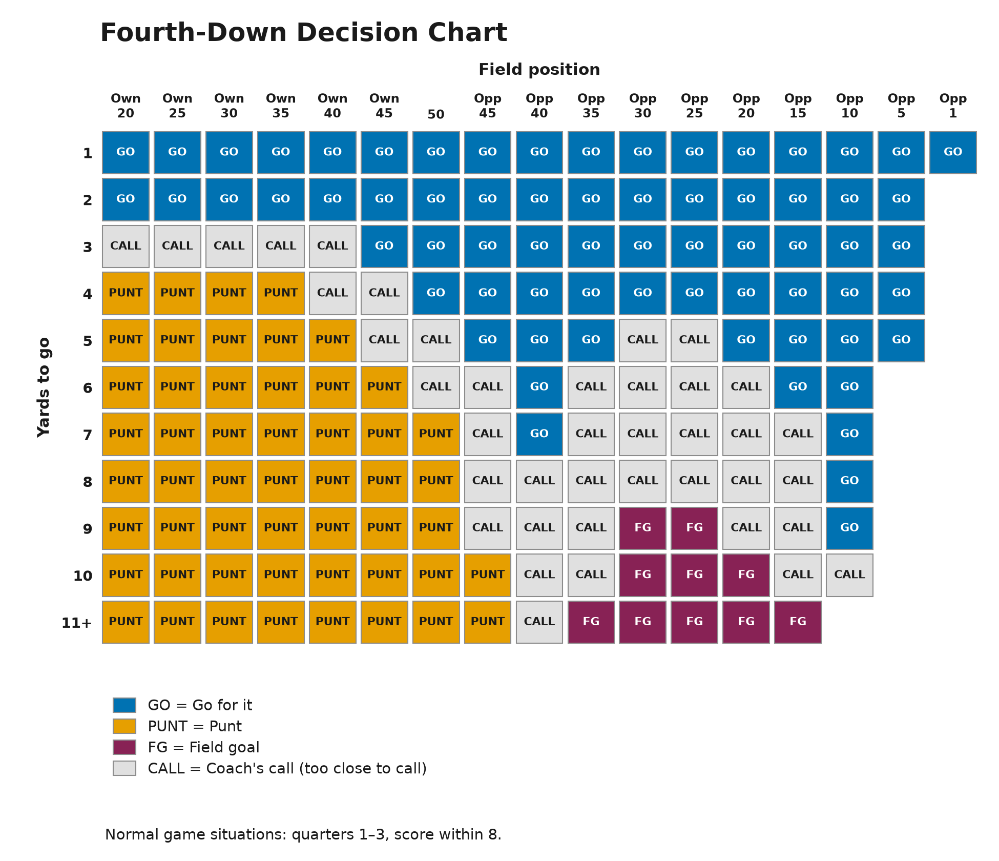
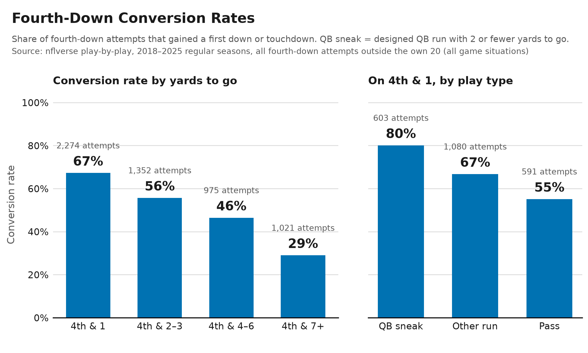

# Fourth-Down Risk for an Underdog

**For:** Carolina Panthers head coach · **Date:** November 8, 2026
**As of:** game results through our Week 9 loss to Denver (6 late Week 9 games not yet included); fourth-down play-by-play through Week 8.

## Bottom line

- **Being the underdog doesn't change the math.** Going for it pays off about the same for underdogs and favorites.
- **Go for it on short yardage.** Go on 4th & 1–2 everywhere, and on 4th & 3–5 from about midfield on.
- **We kick when we should go.** Four of our kicks came where the chart says go, giving up about 3.1 expected points (roughly one field goal).

## The question

- We are projected as the underdog in most remaining games. How much fourth-down risk should we take?

## Context

- **Record:** 3–5 (outscored 199–219); betting-market underdog in 4 of 8 games.
- **Remaining games:** our Elo model has us as the underdog in 6 of 9, with win chances of 21–45% in those six.
- **Aggressiveness:** we went for it on 24% of fourth downs in normal situations (7 of 29), compared with 17% league-wide (7th of 32).

## Scope, data, and assumptions

- **Data:** NFL regular seasons 2018–2025 plus our 2026 games, in normal situations only (quarters 1–3, score within 8).
- **League-average performance:** assumes a league-average kicker, punter and short-yardage offense.
- **Remaining games:** win chances come from our Elo ratings, not betting lines.

## How we analyzed it

- **Expected points** are the average points a possession is worth from a spot on the field. For every fourth down, the chart shows whichever of going for it, punting or a field goal is worth the most.
- **Underdogs vs. favorites:** we compared results after going for it with results after kicking.

## Results

- **What the chart recommends (Figure 1):**
  - **Go** on 4th & 1–2 anywhere, on 4th & 3–5 from about midfield on, and on almost any distance at the opponent's 10 or closer.
  - **Punt** on 4th & 4 or longer from our own 35 and back, and on 4th & 7 or longer out to midfield.
  - **Kick a field goal** on 4th & 9 or longer from about the opponent's 30 to the 20.
  - **Coach's call:** most spots in between, where the top options are too close to call.
  - To read it, find the yards to go (row) and the field position (column).
- **Distance matters most (Figure 2):**
  - Teams converted 67% on 4th & 1 (2,274 tries) but only 29% on 4th & 7+ (1,021).
  - On 4th & 1, the QB sneak converted 80% of 603 tries, ahead of other runs (67%) and passes (55%).
- **No extra payoff for underdogs:**
  - In the 7 spots with enough plays to compare, going paid off more for underdogs in only 2.
  - Underdogs that always went for it on short yardage beat market expectations by about as much as those that sometimes did (6.4 vs. 4.9 percentage points; 79 and 107 games), a difference within the noise.
- **Our decisions vs. the chart:**
  - We matched the chart on 24 of 29 fourth downs; 1 was a coach's call and 4 disagreed.
  - The chart said GO on 11; we went for it on 7.
  - All four misses were kicks, in games where we were favored (expected points given up):
    - Week 6 at PHI: punt, 4th & 1 from our 42 (1.1).
    - Week 3 at CLE: field goal, 4th & 2 at their 22 (1.0).
    - Week 3 at CLE: punt, 4th & 2 from our 44 (0.6).
    - Week 6 at PHI: field goal, 4th & 4 at their 29 (0.3).

## Limitations

- **League averages:** our kicker, punter and short-yardage offense may differ from average.
- **No score or clock adjustment:** late-game and two-minute calls need game context.
- **Underdog comparison:** teams choose when to go, so it shows a pattern, not proof.
- **Small sample for us:** 14 attempts and 29 fourth downs in normal situations.
- **Ratings not fully current:** Week 9 results for three remaining opponents (Tampa Bay, Minnesota, Seattle) weren't in the ratings yet, so remaining win chances may shift slightly.

## Recommendations

- **Use the sideline chart** on every fourth down in normal situations, and go for it on every GO square.
- **Call the QB sneak first on 4th & 1** (80% conversion).
- **Follow the chart on short yardage.** All four misses were 4th & 1–4 kicks in GO squares: two punts near midfield (our 42 and 44) and two field goals inside the opponent's 30 (their 22 and 29).
- **Use the same chart whether favored or not;** save judgment for CALL squares.

*Figure 1. Fourth-down decision chart: the best option by expected points in normal game situations.*

*Figure 2. Conversion rates by yards to go, and on 4th & 1 by play type (2018–2025).*
